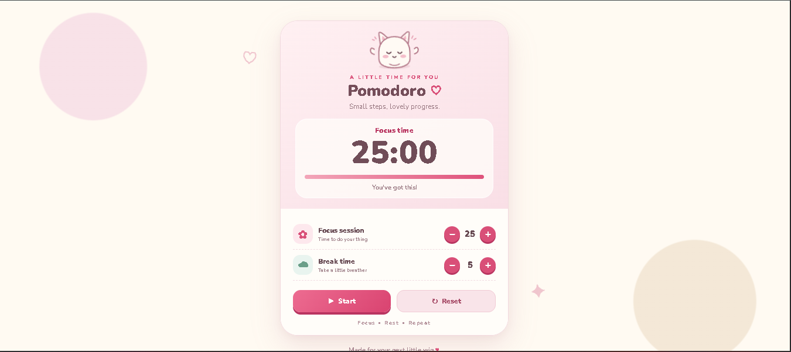

# FocusFlow ⏱️

<div align="center">


### Your personal space for focused work and smarter breaks.

A clean and interactive Pomodoro Timer designed to help you stay focused, manage your time, and build productive habits.

<br/>


</div>

---

## ✨ Overview

**FocusFlow** is a browser-based productivity timer inspired by the Pomodoro Technique. It encourages structured work sessions separated by short breaks, helping users maintain concentration without feeling overwhelmed.

Whether you're studying, coding, reading, or working on a project, FocusFlow gives you a simple way to organize your time and stay on track.

## 🚀 Features

- ⏳ **Countdown Timer** – Track your focused work sessions.
- ▶️ **Start & Pause** – Control your timer whenever needed.
- 🔄 **Reset Functionality** – Restart your session with ease.
- ☕ **Break Sessions** – Switch between work and break intervals.
- 🎨 **Clean Interface** – Enjoy a minimal and distraction-free design.
- 📱 **Responsive Design** – Use the application across different screen sizes.


## 🖥️ Preview

<div align="center">

### Main Interface



</div>

> Add your application screenshot to the `screenshots` folder and name it `focusflow-preview.png`. Replace the image path above if you use a different filename.

## 🛠️ Tech Stack

| Technology | Purpose |
|---|---|
| HTML5 | Application structure |
| CSS3 | Styling, layout and responsive design |
| JavaScript | Timer logic and interactive functionality |
| DOM Manipulation | Updating timer elements dynamically |

## 📂 Project Structure

```text
FocusFlow/
│
├── index.html
├── style.css
├── script.js
│
├── screenshots/
│   └── focusflow-preview.png
│
└── README.md
```

## ⚙️ Getting Started

Follow these steps to run FocusFlow locally.

**1. Clone the repository**

```bash
git clone https://github.com/harvir011/FocusFlow.git
```

**2. Navigate to the project folder**

```bash
cd FocusFlow
```

**3. Open the application**

Open `index.html` in your browser, or use the Live Server extension in VS Code.

That's it! FocusFlow is ready to use.

## 🧠 What I Learned

Building FocusFlow helps explore practical frontend development concepts, including:

- JavaScript functions and event listeners.
- DOM selection and manipulation.
- Countdown logic and time calculations.
- Managing application state.
- Updating the user interface dynamically.
- CSS layouts, transitions and responsive styling.

## 🔮 Future Improvements

Some ideas for extending the project:

- [ ] Customizable work and break durations.
- [ ] Sound notifications when sessions end.
- [ ] Completed session counter.
- [ ] Daily productivity statistics.
- [ ] Persistent settings using Local Storage.
- [ ] Dark and light themes.

## 🌱 Why Pomodoro?

The Pomodoro Technique breaks work into manageable intervals, traditionally 25 minutes of focused work followed by a 5-minute break.

FocusFlow aims to make this technique simple, accessible, and enjoyable.

---

<div align="center">

### Built with focus and a little bit of JavaScript.

**FocusFlow — Make every minute count.**

</div>
